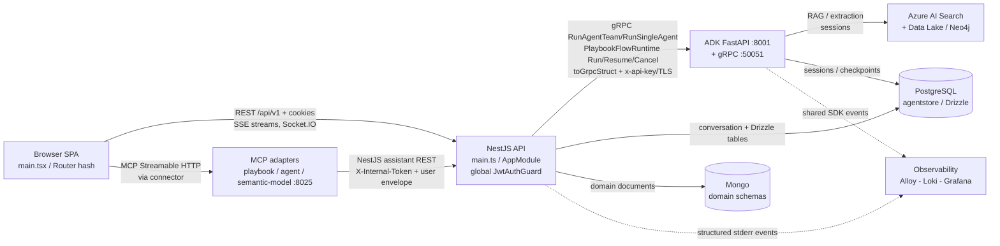

# System architecture overview

Verified implementation baseline. Inspection date: 2026-10-13. Code graph was fresh
(`built_at_sha == HEAD 20ba93a56`, branch `baseline/semantic-model-001`); claims below
were source-verified at the listed paths. Inspection only — no flow was executed for
this baseline.

## Runtimes and entry points

| Runtime | Entry | Serves | Evidence |
|---|---|---|---|
| Frontend SPA | `YellowStorm/front/src/main.tsx` → `src/App.tsx` → hash `src/Router.tsx` | Browser app at `#/conversation` (Conversation route; not Conversation v2 unless requested) | `YellowStorm/front/src/main.tsx:5-14`, `src/App.tsx:127-137`, `src/Router.tsx:13-55` |
| Backend API | `YellowStorm/back/src/main.ts` → `src/app.module.ts` (NestJS/Express) | Versioned REST under `API_DEFAULT_VERSION`/prefix, Socket.IO gateways, gRPC clients to ADK | `YellowStorm/back/src/main.ts:1-60`, `src/app.module.ts:84-166`, `src/modules/auth/auth-cookie-path.ts` |
| ADK runtime | `yellowstorm-adk/main.py:1-54` (FastAPI + gRPC server) | REST/SSE on `:8001`, gRPC on `:50051` | `yellowstorm-adk/main.py`, `yellowstorm-adk/src/grpc_server/server.py:29-39` |
| Code runtime | `yellowstorm-code-runtime/package.json` (Node ESM TS) | Sandboxed code execution helpers, tested via `tests/` | `yellowstorm-code-runtime/package.json:1-14` |
| MCP adapters | `mcp/mcp-playbook/server.py`, `mcp/mcp-agent/*`, `mcp/mcp-semantic-model/*` | FastMCP Streamable HTTP; NestJS stays authoritative | `mcp/mcp-playbook/README.md:1-3`, `mcp/mcp-playbook/server.py:55-57,187-221` |

Deployment boundaries are process-level: frontend static build (`VITE_API_URL` /
runtime `/config.js`), backend NestJS, ADK FastAPI+gRPC (+ Celery worker for batch
extraction), MCP HTTP adapters. No shared in-process imports cross these boundaries;
all cross-service traffic is REST/gRPC/SSE/sockets. See
[cross-service contracts](cross-service-contracts.md).

## Persistence boundaries

- **PostgreSQL (Drizzle, `agentstore` in poc):** conversation domain (conversations,
  messages `components` jsonb, branches, reports, shares, analytics, playbook
  handoffs) plus Drizzle-managed tables in `YellowStorm/back/drizzle/0000-0025_*`.
  Access only via `PostgresModule` (`PG_POOL`/`DRIZZLE_DB`) and per-store tokens
  (`CONVERSATION_STORE`, `MESSAGE_STORE`, …). Migrations: `drizzle-kit generate` /
  `migrate`; schema in `YellowStorm/back/src/modules/postgres/schema/`.
- **Mongo (Mongoose, legacy for conversation):** remaining domains own their schemas
  (`workspace_documents` cited by conversation artifacts, etc.). `messages` /
  `conversations` collections in Mongo are legacy/stale — do not read.
- **Redis / Celery:** ADK batch attribute extraction broker (`attribute_extraction`
  queue); session/citation state also uses PostgreSQL (`DatabaseSessionService`).
- **External:** Azure AI Search (hybrid vector+keyword), Azure Data Lake/blob,
  Neo4j, LiteLLM proxy. See [component map](component-map.md) and
  [ADK runtime](adk-runtime.md).

Authoritative detail: [backend persistence](../backend/persistence.md).

## Runtime and data-flow diagram

Relationships verified: backend gRPC call sites
(`conversation/services/stream.service.ts:1934`,
`playbook-flow/execution/grpc/playbook-flow-runtime-client.service.ts:24-80`,
`grpc-struct.mapper.ts:24-44`); MCP→NestJS client
(`mcp/mcp-playbook/server.py:55-57`, `clients/yellowstorm_playbook_client.py:28-52`);
Postgres access rules
([persistence](../backend/persistence.md)); ADK dual-serve
(`yellowstorm-adk/main.py`, `src/grpc_server/server.py:29-39`).

## Major flows (inspected, not executed)

1. Chat/stream: browser SSE → NestJS `stream.service` → ADK `RunAgentTeam` /
   `RunSingleAgent` → `StreamChunk` (`add`/`update`/`delete`) → SSE to browser.
2. Playbook execution: NestJS `PlaybookFlowExecutionService` → ADK
   `PlaybookFlowRuntime` (`Run`/`RunFromCheckpoint` streaming) → construction stream
   proxied to canvas (`playbooks/:id/intent-constructions/:constructionId/stream`).
3. Widget embed: public page + one-shot token → `WidgetTokenGuard` routes →
   `RunAgentTeam` (`agent_mode: manual`) → SSE chunks.
4. Background: Celery `attribute_extraction` queue (batch extraction + webhook);
   leased Mongo-embedded workers with heartbeat for long jobs.
5. Browser-session / app-runtime sockets: Socket.IO `/browser-session` (1280x720
   viewport contract); app-runtime one-shot tickets, heartbeat, revision rehydration.

Details: [cross-service contracts](cross-service-contracts.md),
[component map](component-map.md), [ADK runtime](adk-runtime.md).

## Verification entry points

- Frontend: from `YellowStorm/front/`: `npm test -- <pattern>`,
  `npx tsc --noEmit -p .`, `npm run build` (bundling/routes).
- Backend: from `YellowStorm/back/`: `npm test -- <pattern>`; contracts
  `npm run test:contracts`; e2e `npm run test:e2e`; Drizzle `db:generate` /
  `db:migrate`; Postgres verify `db:verify`.
- ADK: `conda run -n meta pytest <path> -q`; proto drift
  `yellowstorm-adk/tests/flow_engine/test_proto_drift.py`.
- Observability: `node scripts/observability/check-policy.mjs` (logging changes);
  `node scripts/observability/run-gates.mjs --suite unit` (SDK/contract changes).

## What this baseline does not claim

- Full route/guard table, XState inventory, and conversation-v2 app-shell
  single-connection ownership were not fully traced — see
  [baseline gaps](baseline-gaps.md).
- Historical rationale for observed boundaries is not reconstructed here; accepted
  decisions live in [decisions](../decisions/); unconfirmed items are `proposed`
  or listed as gaps.
- No new schemas, tables, services, modules, or dependencies were introduced by
  this documentation task.
