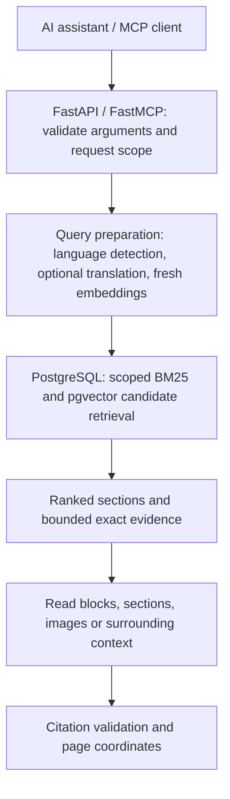

# Logical Indexing MCP: architecture and functions

This project lets AI assistants find and read evidence in documents already
indexed in PostgreSQL. It supports keyword and semantic search, logical section
navigation, tables and images, and page-level citation highlighting. It is the
retrieval service; the separate ingestion project parses files and owns schema
migrations, stored embeddings, and indexed document structure.

The documentation includes three guides and supporting decision/security records:

- [Architecture and functions](logical-search.md): this guide, including tools and API contracts.
- [Operations](operations.md): installation, environment settings, logs, database indexes and load testing.
- [Maintenance history](maintenance-history.md): consolidated audits, implementation reports and production roadmap.
- [Architecture Decision Records](adr/README.md): proposed and accepted architecture choices, alternatives, and consequences.
- [Security cleanup plan](security-cleanup-plan.md): priorities and verification criteria for the security audit findings.

## Architecture



| Component | Responsibility |
| --- | --- |
| `run_mcp_server.py` | Start the application and configure console logging |
| `src/mcp_server/router.py` | HTTP endpoints, bearer authentication, workspace headers, startup/shutdown and MCP transport mounting |
| `src/mcp_server/logical_indexing_server.py` | Public MCP tools, argument validation, orchestration and response budgets |
| `src/mcp_server/search_scope.py` | SQL-owned document scope and filename relevance |
| `src/mcp_server/db_helpers.py` | Database retrieval, readers and citation position lookup |
| `src/mcp_server/section_search.py` | Focused evidence inside selected sections |
| `src/mcp_server/context_navigation.py` | Document hierarchy and context traversal |
| `src/modules/` | Language detection, embeddings, translation and model admission |
| `src/config/settings.py` | `.env` configuration |
| `src/logger/` | Console logging and optional rotating request/SQL logs |

MCP tools require explicit workspace scope. The service bearer key authenticates
the trusted backend, which supplies dynamic workspace IDs in `Workspace-Id`
outside the LLM. There is no static workspace configuration. Tool and standalone
HTTP body scopes cannot exceed that required header; filename-only discovery is
also filtered to it. User membership checks belong to the backend/gateway. See
[security configuration](security-configuration.md) and
[ADR-0002](adr/0002-dynamic-workspace-scope-from-trusted-header.md)
for the gateway boundary and deployment responsibilities.

Only `models/lid.176.bin` is used locally, for fastText query-language detection.
Startup verifies its checksum. Query and filename embeddings are computed by the
configured remote embedding provider on every request; there is no cross-request
embedding/result cache or identical-query coalescing. Translation and filename
semantics can be disabled independently through `.env`.

For receiving-agent instructions, load one of the repository's policies:
[compact navigation](../skills/smart-navigation-search-gpt5.4mini.md),
[detailed navigation](../skills/smart-navigation-search-skill.md), or
[search-only navigation](../skills/smart-navigation-search-no-document-strategy.md).
These describe evidence completeness and citation usage for the calling agent.

Scalable discovery keeps document filters in SQL and loads metadata only for
bounded candidates. It retains the ranking formula, but changed database plans
can alter BM25 scores/order and approximate vector candidates. See
[operations and scaling](operations.md#large-database-search) for compatibility
limits, rollback and measurement instructions.

## Database model

The service reads five tables defined in `src/db/models.py`:

| Table | Stored data |
|---|---|
| `logical_documents` | File metadata, workspace, source, page count, overview, and language/FTS configuration. |
| `logical_sections` | Section IDs, titles, title search vectors, embeddings, and starting pages. |
| `logical_blocks` | Searchable content, block types, section links, embeddings, pages, and bounding boxes. |
| `logical_images` | Base64 images, visual embeddings, optional legacy descriptions, page positions, and detected words. |
| `logical_text_positions` | Word-level text and coordinates used for precise citation highlighting. |

The server creates database engines lazily. `run_mcp_server.py` does not call the included `init_db()` helper, so startup neither creates the schema nor imports any documents.

### Database ownership

The indexing project owns the PostgreSQL schema and all migrations. This MCP
service is a read-only schema consumer and must not run migrations at startup.
For a new database, the indexing migration must install `pgvector` and
`pg_search`, create the five tables above, populate `workspace_id` on documents,
sections, and blocks, and provide these indexes (names may differ when the
definitions are equivalent):

- B-tree indexes on documents `(workspace_id, file_name, id)`, sections
  `(workspace_id, document_id)`, and blocks `(workspace_id, document_id)`.
- HNSW cosine indexes on section, block, and image `halfvec` embeddings.
- ParadeDB BM25 indexes on section titles and block content.

Deploy and run indexing migrations before deploying an MCP version that depends
on a new schema contract.

## What the project does

The server exposes MCP tools for four related jobs:

1. **Choose a reading strategy** based on document length.
2. **Find evidence** using semantic vector search and PostgreSQL full-text search.
3. **Read exact context**, including sections, blocks, pages, and images.
4. **Validate citations** and map evidence back to a page and bounding box.

The stored information is organized like this:

```text
Workspace
  └── Document
      ├── Section
      │   └── Block (heading, paragraph, table, image description, ...)
      ├── Image
      └── Text positions (words and page coordinates)
```

Images are stored separately, while their generated text descriptions can also appear in searchable blocks. This lets a query find a chart or figure by its meaning and then retrieve the actual image for inspection.

## How a question is processed

### When one or more document IDs are known

MCP tools identify documents by the indexed `LogicalDocument.id`, returned as
`document_id`. Supply that ID rather than the original filename. Tool responses
return `document_id`; filename-based HTTP endpoints keep their existing contract.

For a targeted question, call `search(query, workspace_id, document_id)` directly.
The `document_id` argument accepts one string or a list, so batch all known files.
Use `get_document_strategy(workspace_id, document_id)` when choosing how to read
complete known files:

- The response contains grouped `next_tool_calls`, not one strategy record per
  file. Execute those calls directly.
- Files with at most `PAGE_THRESHOLD` pages (20 by default) are combined into
  one `read_content` call. That group may contain only one file out of six.
  Its `after_success` contract marks only those files retrieval-complete. Once
  `read_content` succeeds, do not search, read sections/blocks, or
  expand context for those files; proceed to the terminal citation locator.
- Larger files are combined into one `search` call. Add the user's query.
- `read_sections` takes one or more unique section IDs, `read_blocks` takes one
  or more unique block IDs, and `expand_context` takes section IDs. None accepts
  `document_id`; batch all known IDs into one tool call.

Example grouped response for six files where only one is `read_all`:

```json
{
  "workspace_id": "workspace-id",
  "next_tool_calls": [
    {
      "tool": "read_content",
      "arguments": {
        "workspace_id": "workspace-id",
        "document_id": ["doc-small"]
      }
    },
    {
      "tool": "search",
      "arguments": {
        "workspace_id": "workspace-id",
        "document_id": ["doc-large-1", "doc-large-2", "doc-large-3", "doc-large-4", "doc-large-5"]
      }
    }
  ],
  "not_found_document_ids": []
}
```

### When the document ID is unknown

Do not call `get_document_strategy` without document IDs. Call the unified MCP
`search(query, workspace_id)` tool directly without a `document_id` argument so
it searches across the workspace.

The unified `search` call:

1. embeds the query through the configured OpenAI-compatible LiteLLM endpoint;
2. searches section titles with semantic and full-text signals;
3. searches individual blocks with semantic and full-text signals and images with visual vectors;
4. ranks matching sections with configurable weights, defaulting to 75% combined content
   RRF, 20% section-title RRF, 3% filename text relevance, and 2% filename semantics;
5. returns grouped documents and sections with exact block evidence, IDs,
   scores. There is no separate filename-suggestions list.

Filename text matching normalizes Unicode, case, separators, extensions, and
10-K/10-Q spellings and fiscal-year expressions (FY2018, FY 2018, fiscal year
2018) in already scoped document metadata. Text matching uses exact tokens,
not substrings. Matching issuer names in structured
issuer_YEAR document IDs narrows candidate discovery to those documents. Multiple
named issuers keep their union; unknown issuers do not narrow scope. Ordinary
topic words and years only contribute a filename relevance boost. Generic words
such as annual, report, and policy do not establish issuer identity. Filename
matches cannot create sections without a block, image, or section retrieval candidate.
The supplied query provides filename context for each call. A calling agent
rewriting a query should preserve company, year, and other filename clues.

Filename semantics compares a decomposed filename query (company/year/form
clues when available) with normalized filename text. If no exact clues are
found, it uses normalized query text to permit semantic synonym matching.
Embeddings are batched from normalized text and calculated fresh on every call.
Stored filename embeddings and the indexing process are unchanged. Only authorized workspace/file/document candidates are embedded.
Exact issuer selection still controls scope. At most
`SEARCH_FILENAME_SEMANTIC_MAX_FILES` (default 100) document IDs are scored per
call, selected by text relevance and deterministic filename order. The optional
stage is bounded by `SEARCH_FILENAME_SEMANTIC_TIMEOUT_SECONDS` (default 5s),
preserves the content retrieval time reserve, and contributes zero semantic
filename bonus if unavailable. Cached entries may be reused across calls.

Content and title ranks use the configured weighted RRF. Content combines block
text-vector, block BM25, and image-vector ranks; image and text vectors have equal
`HYBRID_VECTOR_WEIGHT`. Only the best rank in each channel represents a section.
When eligible image candidates exist, content RRF is normalized over all three
channels; otherwise the previous two-channel normalization is preserved. Defaults:
`0.75 * block_rrf + 0.20 * section_rrf + 0.03 * filename_text_rank + 0.02 * filename_semantic_rank`.
`SEARCH_BLOCK_WEIGHT`, `SEARCH_SECTION_WEIGHT`, and `SEARCH_FILENAME_WEIGHT`
default to `0.75`, `0.20`, and `0.05` and must sum to one. Within the filename
weight, enabling filename semantics allocates 40% to semantics and 60% to text,
giving 2% and 3% of the overall score. Disabling it allocates the entire filename
weight to text, yielding `0.75 * block_rrf + 0.20 * section_rrf + 0.05 * filename_text_rank`.
`SEARCH_FILENAME_SEMANTIC_SHARE` is no longer a runtime setting; use only
`SEARCH_FILENAME_SEMANTIC_ENABLED` to choose the split.
Filename overlap counts produce tied ranks, normalized as `(k+1)/(k+rank)`;
equal matches receive equal scores. Filename semantic cosine values are also
converted to normalized ranks after the configured minimum similarity filter.
Raw block cosine values remain diagnostic signals
but are not added to the final score. The strongest block rank per channel
represents each section, so long sections do not gain a bonus from block count.
Final score ties are broken by document and section IDs.

MCP `search` always ranks the strongest matches globally, applying a per-document
quota when multiple documents are in scope. Results are grouped into documents,
sections, and exact block evidence. It does not report evaluation of every file.
The HTTP `/search_documents` endpoint retains its separate coverage option.

Use returned evidence directly when sufficient. For missing section details,
batch selected IDs in `read_sections`; use `read_blocks` for truncated block text
and `search_in_sections` for focused gaps. Search omissions do not establish
that no further relevant content exists. Call `expand_context` for selected sections only when
their surrounding hierarchy is needed to interpret or support the answer.

### Citation flow

After drafting an answer, the assistant calls the citation locator as its final
retrieval step. Citation locators have no `document_id` argument. Prefer numeric
internal block IDs copied from retrieval. External parser aliases are accepted
only when they resolve unambiguously inside the authorized workspace scope.
Ambiguous targets are omitted, including internal/external ID collisions.

```text
Question
  → strategy or search
  → read relevant context
  → draft answer
  → locate_answer_citations
  → answer with only validated references
```

For normal indexes, `locate_answer_citations` matches the cited evidence against stored word positions and returns:

- the source document location;
- the page number;
- the matched text;
- a PDF-space bounding box `[x, y, width, height]` when coordinates are available.

Requests marked with the `Mistral` or `X-Mistral` header expose `locate_answer_citations_mistral` instead. That variant uses the block bounding box because Mistral-indexed documents may not contain word-level text positions.

Both text citation paths require evidence to occur in the stored block. Matching
allows whitespace/case differences, but preserves punctuation, numbers, signs,
and negation. The standard path also verifies the matched word-position text;
fuzzy position matching alone cannot validate a citation. Returned highlight text
comes from the source. Unmatched evidence is omitted using the existing
`citations` response envelope.

Image evidence must occur in the stored image description or OCR words. If only
the description matches, the result uses the whole-image bounding box and matched
description text. This locates stored evidence; it does not verify the factual
accuracy of a generated image description or the final answer's entailment.

## Main MCP tools

| Tool | Purpose |
|---|---|
| `get_document_strategy` | Choose a reading approach for complete known files; returns grouped `read_content`/`search` follow-up calls. |
| `read_content` | Read complete indexed documents as section-grouped text chunks with images in one call; no pagination or delivery metadata. A document ID list returns one result per document. |
| `search` | One hybrid retrieval pass across blocks, section titles, and document IDs. Returns grouped documents, sections, and exact block evidence. `top_k` limits 1–10 sections per call (default 5). The calling agent may rewrite the query for an unresolved gap and optionally pass `exclude_section_ids` from previous results. Exclusion filters section and block candidate queries before their limits. There are no server rewrite or loop-count arguments. |
| `read_sections` | Read selected sections and their images; preview blocks over 1000 characters and point to `read_blocks` for full text. |
| `read_blocks` | Read one or more exact blocks in full by internal or external block ID. |
| `expand_context` | Read bounded ancestor and descendant context when selected evidence needs surrounding hierarchy; skip it when the evidence is sufficient. |
| `locate_answer_citations` | Validate citations by unique block/image IDs; no `document_id` argument. |
| `locate_answer_citations_mistral` | Locate Mistral citations by unique IDs; no `document_id` argument. |

### Image delivery by tool

Both citation locators accept `evidence_text=""` to cite an entire block or image.
This supports visual descriptions of images without text: the citation returns
the full stored content (which may be empty) in `highlight_text` and the whole
target bounding box in `highlight_bbox`. Missing/null evidence remains invalid.
Nonempty evidence still needs a verified source match. Unknown or ambiguous IDs
are omitted, and workspace authorization applies to whole-target citations too.

| Tool | Returns actual MCP image items? |
|---|---|
| `search` | Yes, for image evidence retained after ranking and text budgeting. |
| `search_in_sections` | Yes, for retained image hits and image neighbors. |
| `read_content` | Yes, for all stored images in the full document's content chunks. |
| `read_sections` | Yes by default; `include_images=false` explicitly returns descriptions only. |
| `read_blocks` | Yes, when a selected image block links to a stored image. |
| `expand_context` | Yes for image markers in delivered content; no with `include_content=false`. |
| `get_document_strategy` | No; returns reading strategy metadata. |
| `locate_answer_citations`, `locate_answer_citations_mistral` | No; return source locations and highlights. |

Image-producing responses contain JSON/text evidence followed by native MCP
`ImageContent` items. `image_id` and `image_content_index` link evidence to those
items; repeated references to one image share one attachment. Image payloads are
loaded only after evidence selection, inside the authorized workspace scope.
`read_content` returns the full indexed content without byte or row limits. Each
result has `document_id`, `workspace_id`, `total_pages`, and `content`, an array of
chunks with `content` text and `images`. Each section's blocks are joined in one
chunk with its heading; compact inline `[block_id: ID]` markers support citation
lookup. Text outside sections and headings without direct blocks are retained.
It has no `pagination`, `delivery`, `retrieval_complete`, or continuation fields.

Other retrieval tools have separate text and image budgets: image attachments use
`READ_CONTENT_BATCH_MAX_BYTES`. Search, block and context image records expose
`image_status`: `returned`, `not_found`, `unavailable`, or `omitted_byte_budget`.
For omitted payloads, read the containing section with `include_images=true`.
The standalone HTTP `search_native` endpoint remains a JSON text-section API,
not an MCP image-producing tool.

Vector retrieval searches `logical_blocks.embedding` for text content and
`logical_images.image_embedding` for visual content, using one query vector from the
same compatible model. Image descriptions/OCR belong in blocks and remain
searchable with BM25, even when their text embedding is absent. Images with no
description or corresponding block can independently discover a section and
return evidence identified by `image_id`. No block ID is invented for them.
Image vectors are nullable `halfvec(EMBEDDING_DIMENSION)` and are deferred during
ordinary image reads. Ingestion owns the column, vector population, and indexes;
deploy that schema before this service. Search does not load stored vectors or
image bytes into Python during candidate ranking.

The server also exposes read-only MCP resources under `logical://documents` and `logical://document/{document_id}/...` for document metadata, overviews, blocks, and sections.

The calling agent owns follow-up search. Inspect evidence first, then rewrite
or decompose only for a specific unresolved gap; no advance iteration count is
required. Preserve workspace/file scope, company names and requested dates.
For discovery of different sections, optionally pass positive numeric public
`section_id` values in `exclude_section_ids`, for example `[101088, 101056]`
when those IDs were actually returned. Do not pass block IDs or local `sec_*`
labels. The list is bounded by `REQUEST_COLLECTION_MAX_ITEMS` and is stateless:
the agent maintains and resends exclusions on each call. Outside-scope IDs do
not widen access or affect scoped results. Excluded sections cannot re-enter
through their blocks, but hierarchy references may still mention them. Prefer
`search_in_sections` or reading tools for details inside already known sections.

## Request security and scope

Every HTTP request requires this header:

```http
Authorization: Bearer <MCP_API_KEY>
```

MCP initialization and schema discovery do not require workspace IDs. Each
document tool call or resource read requires the current workspace scope:

```http
Workspace-Id: finance
```

The `workspace_id` passed to an MCP tool must be contained in the `Workspace-Id`
header. Initialization does not bind the session to a workspace; trusted callers
can supply different workspace headers on later requests. Multiple header values
and comma-separated workspace IDs are supported.
Anyone holding `MCP_API_KEY` may select the workspace scope, so the key must only
be shared with trusted callers.

Data-bearing REST endpoints also require `Workspace-Id` and validate body scope
against it. JSON requests additionally require `Content-Type: application/json`.

`logical_documents.user_id` exists in the schema, but retrieval authorization
uses the authenticated caller's `Workspace-Id` header rather than that column.
A deployment whose ACLs are user-specific must resolve permitted scopes from an
identity provider or server-side ACL resolver.

The server currently has no cross-request cache of retrieved document evidence.
Embedding-client and database-schema caches contain no document results. Any
future evidence/result cache must include the canonical effective workspace
scope in its key and revalidate that scope before returning a cached result.

Optional request headers are:

| Header | Effect |
|---|---|
| `Mistral: true` or `X-Mistral: true` | Switches the exposed citation locator to the Mistral variant. |

### Standalone document summary endpoint

`POST /summarize` is a REST endpoint, not an MCP tool. It accepts
`workspace_id` and `file_name` as either non-empty strings or non-empty lists.
It returns the stored `table_of_contents`; batched requests return one result
per workspace/file pair. Documents under 50 pages include a normalized preview
of up to 100 characters after each section title, while larger documents return
titles only.

```http
POST /summarize
Authorization: Bearer <MCP_API_KEY>
Content-Type: application/json
```

```json
{
  "workspace_id": "workspace-id",
  "file_name": "report.pdf"
}
```

### Standalone document routing-profile endpoint

`POST /routing-profile` is a REST endpoint, not an MCP tool. It accepts exactly one
`workspace_id` and one `file_name` as non-empty strings; lists are rejected.
It loads representative text from every document section. Each section retains
up to 8,000 characters sampled from its beginning, middle, and end, and sections
are sent to the configured OpenAI-compatible LiteLLM model in bounded concurrent
batches. The first pass produces grounded section summaries, search terms, and
entities. Documents above 50 pages receive an additional topic-consolidation
pass. A final pass synthesizes a search-oriented document description and the
structured routing fields. Every model response is parsed and validated before
deterministic metadata is added. All generated summaries, descriptions, topic
labels, keywords, and document-type labels are returned in English regardless
of the source document's language; established proper nouns and identifiers are
preserved.

```http
POST /routing-profile
Authorization: Bearer <MCP_API_KEY>
Content-Type: application/json
```

```json
{
  "workspace_id": "workspace-id",
  "file_name": "report.pdf"
}
```

```json
{
  "document_id": "507f1f77bcf86cd799439011",
  "description": "This annual report explains the organization's governance structure, financial performance, risk controls, and the results and procedures users can investigate in the document.",
  "document_type": "annual_report",
  "main_topics": ["Governance", "Financial results"],
  "secondary_topics": ["Risk management"],
  "entities": ["PostgreSQL"],
  "topic_summaries": [
    {
      "topic_index": 0,
      "title": "Financial results",
      "summary": "Explains the reported financial performance, underlying measures, and related findings."
    }
  ],
  "generated_at": "2026-07-20T12:00:00Z"
}
```

`document_id` and `generated_at` are added by the server rather than generated
by the model. Documents with more than 50 pages receive topic summaries. Documents
of 50 pages or fewer return an empty `topic_summaries` list. `description`, topic
summaries, topics, and entities are separate fields so a downstream document
index can embed or keyword-index them independently. This service does not write
those fields to an external document index; the profile consumer must do
that ingestion.

## Search preparation and performance checks

Search preparation shares one request-local document scope for language
selection, filename scoring and candidate retrieval. The scalable path keeps
that scope in SQL; the rollback path loads scoped metadata once. Query embedding, multilingual query preparation, and
filename semantic scoring run concurrently after scope validation. Candidate
limits, ranking weights, workspace predicates, and evidence assembly are unchanged.

Query and filename embeddings are generated fresh for every search. There is
no cross-request vector cache or coalescing of identical queries. Model admission
limits and deadlines still apply to each calculation.

Translation reuses one API client per event loop. Server shutdown drains admitted
operations before closing it. Standalone async callers should also call
`close_translation_client()` before closing their event loop. Translation outputs
are not cached.

Run `python -m scripts.setup_database` for a read-only database catalog check.
Use `--apply` once after ingestion prepares the database to supply missing
extensions and search indexes. This command is independent of server startup
and does not run search queries or model calls. See
[maintenance scripts](../scripts/README.md) for ownership and setup limits.

## Navigation with direct evidence

`search` keeps the existing section-ranking formula and always returns grouped
evidence. The response groups files/workspaces under
`documents`, each with `sections`. Section entries include `section_id`, `title`,
`score`, `rank`, `blocks`, and `has_more_blocks`. Each block contains exact source
text, its ID/type, a local evidence score, and `content_truncated`. Image descriptions
use the same list; linked images include both IDs and unmatched images only image_id.
Image bytes are not returned by search. Rank preserves discovery order across
document groups and iterative passes; scores from different queries are not calibrated.

The HTTP `/search_native` and `/search_documents` contracts are unchanged.
The new tool is registered with FastMCP and appears through the existing `/tools`
listing and MCP transports; it does not add another REST route.

### Search within selected sections

```json
{
  "query": "cancellation fee and exceptions",
  "section_id": ["14390"],
  "workspace_id": "workspace-1",
  "top_k": 3,
  "include_neighbors": true
}
```

Pass this to `search_in_sections`. It ranks only content inside the authorized
sections. PostgreSQL lexical ranking includes the section title; block text and
image visual embeddings supply semantic ranking. Linked evidence uses the
stronger vector similarity and is returned once. No minimum score excludes details merely
because they omit the subject. The tool falls back to lexical ranking when an
embedding provider is unavailable. Separate image records retain legacy lexical
scoring and also use their visual embeddings when available.

Global section discovery still uses its existing BM25/semantic ranking. Evidence
selection prioritizes its already-matched block and image, then bounded additional evidence.
The local evidence score is a separate heuristic and is not answer confidence.
The default neighbor option adds up to two blocks per primary text/image block,
inside the same section. Excerpts remain in document order. Image/block duplicates
are matched on document, section, page, and bounding box. Positioned images do
not need duplicate descriptions; when the bounding box is absent, descriptions
must match as well. An explicit ingestion-owned image-to-block link remains
preferable when available.

### Read only what is missing

- `read_sections(query=..., include_images=false)` focuses long-block excerpts and
  omits binary images. Its defaults preserve existing visual reading behavior.
- `read_blocks` returns full text when it fits; use a single block ID and
  `content_offset=next_content_offset` to continue oversized blocks. Retry selected
  `not_evaluated` IDs separately. Offsets count source characters.
- Set `include_hierarchy=true` to include both `ancestors` (root-to-parent)
  and all-level `descendants`, with numeric public IDs, titles, full counts,
  and truncation flags. The default false omits these fields and skips hierarchy
  loading. Navigation can be trimmed before block evidence. Read selected content
  using `read_sections` or `expand_context`.
- `expand_context` reads the selected section, all descendants recursively,
  and each ancestor's own blocks. It returns one combined `content` string
  with section labels and citation markers containing `block_id` or `image_id`.
  A batch has one combined content field and separate `contexts` metadata.
- Expansion stops at the chosen subtree boundary. It does not automatically
  promote leaves to their parents, skip children after finding an answer,
  or cap traversal at two children. Ancestors' unrelated branches are excluded.
- Follow `required_next_tool_call` whenever `has_more=true`. Continuations use
  one root, a character `content_offset`, and the returned `context_version`.
  Concatenating pages reconstructs the exact content; changed sources require
  restarting. The serialized response shares `SEARCH_EVIDENCE_MAX_BYTES`.
- `context_complete` describes delivery of the selected context after prior
  pages are read. Missing references and cycles appear in `hierarchy_issues`.
  `boundary` exposes parent and adjacent sibling IDs/titles. It is a structural
  boundary, not a guarantee that the subject changes there.
- `expand_context(include_content=false)` returns selected IDs/titles without
  loading blocks. `read_sections` still reads direct section blocks only.
- Use `read_sections(include_images=true)` to visually verify charts or figures.

### Limits and completeness

Defaults: `SEARCH_SECTION_BLOCK_LIMIT=3`, `SEARCH_EVIDENCE_MAX_CHARS=1000`,
`SEARCH_EVIDENCE_MAX_BYTES=24000`, `SECTION_SEARCH_MAX_SECTIONS=10`.
Search excerpts share one serialized UTF-8 JSON byte budget across all iterations.
These are byte/character limits, not exact token limits. Settings can be overridden
through the existing environment configuration. No schema migration or reindexing
is required.

`content_truncated` means part of one source is missing; `content_offset` locates
the exact excerpt. `has_more_blocks` means section evidence was omitted.
`budget_exhausted` means output was omitted to fit the aggregate limit.
Extremely large metadata can cause whole trailing sections to be omitted, reported
as `sections_omitted`. Search is never proof that all relevant evidence was read.

### Evaluation

Evaluate grouped search evidence with representative questions. Include title-only
matches, late-block answers, adjacent exceptions, charts, multiple files, and
multiple workspaces. Measure complete-session tokens, correctness, evidence
coverage, tool calls, and latency. Smaller responses or fewer calls alone do not
establish improved answer quality. Real-user token savings are not yet measured.

## Optional hierarchy navigation in search

`search` accepts one boolean argument, `include_hierarchy`, defaulting to `false`.
When true, it returns both enclosing ancestor section IDs and titles in
root-to-parent order and all descendant levels below each matched section in
source order. When false, both navigation lists and their metadata are omitted.

The agent chooses this argument from what it needs to answer the question.
Enable hierarchy when interpretation depends on enclosing scope, applicability,
definitions, or prerequisites, or when a complete account requires related
components, dependencies, alternatives, qualifications, or completion criteria.
Leave it false when the returned evidence gives a self-contained localized
answer. The service does not infer it from query keywords.

For example:

```json
{
  "query": "Explain the approval requirements and their exceptions",
  "workspace_id": "workspace-1",
  "include_hierarchy": true
}
```

A matched section can include:

```json
{
  "section_id": 100,
  "title": "Approval",
  "ancestors": [{"section_id": 90, "title": "Governance"}],
  "ancestor_count": 1,
  "ancestors_truncated": false,
  "descendants": [
    {"section_id": 101, "title": "Requirements"},
    {"section_id": 102, "title": "Exceptions"}
  ],
  "descendant_count": 2,
  "descendants_truncated": false
}
```

Disabled navigation fields are omitted. A requested navigation list can be empty
when a section has no ancestors or descendants. Descendant navigation replaces
the search response's former `children`, `child_count`, and `children_truncated`
fields. It includes grandchildren and deeper levels, excluding the matched
section itself, its ancestors, and unrelated sibling sections.

All entries use numeric public section IDs and titles. Full counts remain
available even when the response size limit trims navigation. A true truncation
flag means the map is incomplete. Navigation is trimmed before useful evidence
is discarded. False skips the hierarchy lookup entirely.

The flag applies to grouped evidence in each search call. Navigation does not load full descendant content. Use the map to
select relevant `read_sections` calls or `expand_context` for an entire chosen
subtree. Section names alone do not support an answer; read the content needed
to resolve omissions and establish the requested scope and completeness.

## Document routing API

## `/search_documents` endpoint

### Purpose

`POST /search_documents` is a document-routing endpoint. Given a query and filenames, it either returns the most relevant indexed documents (`best_matches`) or checks a bounded set of them individually (`coverage`). It does not generate an answer.

The endpoint performs hybrid retrieval over indexed document structure and content, aggregates evidence by filename, removes weak candidates, and returns a compact ranked response.

### Authentication and search scope

The endpoint requires only JSON content type and the server's bearer token:

```http
Authorization: Bearer <MCP_API_KEY>
Content-Type: application/json
```

Its document scope is the request's `file_names` across indexed workspaces:

```text
logical_documents.file_name IN request.file_names
```

Therefore:

- it does not search every indexed file;
- it does not accept a caller-provided user ID as authority;
- filenames outside the supplied list cannot become candidates.
- same-named documents in different workspaces remain separate.

### Request

```json
{
  "query": "employees with PostgreSQL experience",
  "file_names": [
    "amine_cv.pdf",
    "sarah_cv.pdf"
  ],
  "behavior": "best_matches",
  "debug": false
}
```

#### Request fields

| Field | Type | Required | Default | Meaning |
|---|---:|---:|---:|---|
| `query` | string | yes | — | Non-empty query used for semantic and lexical retrieval. Surrounding whitespace is removed. |
| `file_names` | array of strings | yes | — | Non-empty list defining which unique indexed files may be searched. Empty values are rejected and exact duplicate values are removed. |
| `behavior` | `best_matches` or `coverage` | no | `best_matches` | Global candidate discovery or bounded per-document evaluation. |
| `debug` | boolean | no | `false` | When enabled, includes detailed retrieval evidence under the top-level `debug` field. |

### Retrieval pipeline

```text
query + file_names
              │
              ▼
     determine scoped FTS languages
     create query embedding and FTS variants
              │
       ┌──────┴───────────┐
       ▼                  ▼
 section/block hybrid     document metadata
 retrieval                matching
       │                  │
       └────────┬─────────┘
                ▼
       group by canonical scoped document ID
                ▼
       calculate document scores
                ▼
 absolute + relative filtering
                ▼
        ranked document candidates
```

#### 1. Query preparation

The endpoint first reads the PostgreSQL full-text-search configurations used by documents inside the requested scope. If no scoped documents exist, it immediately returns an empty result.

Otherwise, it prepares in parallel:

- an embedding for the original query;
- language-aware full-text query variants.

#### 2. Hybrid section and block retrieval

The unified search considers several signals:

- semantic similarity against section-title embeddings;
- PostgreSQL full-text/BM25 matching against section titles;
- semantic similarity against indexed block content;
- PostgreSQL full-text/BM25 matching against blocks.

Image, figure, and chart descriptions produced during indexing are stored as block content. They therefore participate in semantic and lexical retrieval like other blocks.

Vector and BM25 ranks are combined using normalized weighted Reciprocal Rank Fusion. The default fusion settings are:

```text
HYBRID_RRF_K = 60
HYBRID_VECTOR_WEIGHT = 0.8
HYBRID_BM25_WEIGHT = 1.0
```

For `best_matches`, the endpoint retains up to 100 block candidates, admits at most three matches per canonical document ID, scores the grouped documents, and returns at most ten documents. For `coverage`, it evaluates up to ten scoped document IDs separately, with up to three block candidates per document. These are bounded server settings, not request parameters.

#### 3. Section-candidate admission

A retrieved section is kept when at least one of these conditions is true:

- its section title has a real lexical/BM25 match;
- one of its blocks has a real lexical/BM25 match;
- its block-content vector score is at least `SEARCH_DOCUMENTS_MIN_VECTOR_SCORE`.

The default semantic threshold is:

```text
SEARCH_DOCUMENTS_MIN_VECTOR_SCORE = 0.5
```

Lexical evidence is recorded separately from fused scores. This matters because a positive hybrid score can otherwise have been produced only by vector ranking.

#### 4. Metadata matching

The endpoint separately examines these scoped document fields:

- filename;
- source;
- stored overview.

A metadata candidate is accepted only when the complete normalized query phrase is present or every query token is present across the searchable metadata. A partial match on one generic word from a multi-word query is not sufficient.

The metadata score combines query-token coverage with an exact-filename bonus.

#### 5. Canonical document grouping

Results are grouped by `logical_documents.id` after workspace and filename scope
resolution. Distinct database documents are not merged merely because their
filenames are equal or differ only by case. Filename case folding is not used as
identity because ingestion/storage do not enforce that invariant.

#### 6. Document-level scoring

Matches inside each grouped document are sorted by score. Up to the three strongest matches contribute:

```text
content_score = min(
  1.0,
  best_match
  + 0.15 × second_match
  + 0.05 × third_match
)
```

The base document score is the stronger of the aggregated content score and metadata score:

```text
base_score = max(content_score, metadata_score)
```

If any retained section or block has real lexical evidence, the document receives a configurable lexical bonus:

```text
document_score = min(1.0, base_score + lexical_bonus)
SEARCH_DOCUMENTS_LEXICAL_BONUS = 0.08
```

This allows confident semantic-only documents to remain eligible while favoring documents supported by exact lexical evidence.

#### 7. Final filtering

Documents are sorted by document score. The best document establishes a relative acceptance threshold:

```text
relative_floor = best_score × SEARCH_DOCUMENTS_RELATIVE_SCORE
accepted_floor = max(SEARCH_DOCUMENTS_MIN_SCORE, relative_floor)
```

Default values:

```text
SEARCH_DOCUMENTS_MIN_SCORE = 0.35
SEARCH_DOCUMENTS_RELATIVE_SCORE = 0.7
```

A `best_matches` document must score at least `0.35` and at least 70% of the best candidate's score; at most ten accepted documents are returned. Coverage uses the absolute threshold independently for each evaluated document, so one strong document cannot suppress another document's real hit.

This relative filter is intended to remove plausible but substantially weaker semantic matches, such as an unrelated CV appearing below a strongly matching recipe document.

### Normal response

With `debug: false`, the endpoint returns:

```json
{
  "query": "employees with PostgreSQL experience",
  "behavior": "best_matches",
  "documents": [
    {
      "document_id": "507f1f77bcf86cd799439011",
      "file_name": "amine_cv.pdf",
      "score": 0.91,
      "rank": 1
    },
    {
      "document_id": "507f191e810c19729de860ea",
      "file_name": "sarah_cv.pdf",
      "score": 0.84,
      "rank": 2
    }
  ],
  "total": 2,
  "debug": null
}
```

#### Response fields

| Field | Meaning |
|---|---|
| `query` | The normalized request query used by the endpoint. |
| `behavior` | The selected `best_matches` or `coverage` behavior. |
| `documents` | Accepted candidates ordered from most to least relevant. |
| `documents[].document_id` | Mongo-style string ID of the indexed document represented by the grouped candidate. |
| `documents[].file_name` | Original indexed filename. |
| `documents[].score` | Final document-level score after aggregation and lexical bonus, rounded to four decimal places. |
| `documents[].rank` | One-based position in the final result. |
| `total` | Number of returned documents after grouping and filtering. |
| `debug` | `null` unless debug mode was requested. |

If nothing passes retrieval and filtering, the endpoint returns HTTP 200 with:

```json
{
  "query": "query with no matching document",
  "documents": [],
  "total": 0,
  "debug": null
}
```

### Debug response

With `debug: true`, the compact `documents` array is unchanged. The top-level `debug` field contains detailed data for every returned document, including:

- workspace, source, overview, and page metadata when available;
- final `document_score` and `relative_score`;
- `semantic_match` and `keyword_match` flags;
- metadata match score and matched fields;
- every retained section's ID, title, score, preview, page range, and image count;
- per-section retrieval scores and keyword-provenance flags;
- complete section blocks;
- section images and indexed image/VLM content.

Example outline:

```json
{
  "query": "couscous recette",
  "documents": [
    {
      "document_id": "507f191e810c19729de860eb",
      "file_name": "recettes.pdf",
      "score": 0.88,
      "rank": 1
    }
  ],
  "total": 1,
  "debug": [
    {
      "document_id": "507f191e810c19729de860eb",
      "file_name": "recettes.pdf",
      "document_score": 0.88,
      "relative_score": 1.0,
      "semantic_match": true,
      "keyword_match": true,
      "metadata_match": null,
      "matches": [
        {
          "section_id": 101,
          "section_title": "Couscous",
          "score": 0.8,
          "retrieval_scores": {
            "section_title_hybrid": 0.0,
            "content_vector": 0.8,
            "block_hybrid": 0.03,
            "section_keyword_match": false,
            "block_keyword_match": true
          },
          "preview": "Recette de couscous...",
          "page_range": "12-13",
          "image_count": 1,
          "content": {
            "blocks": [],
            "images": []
          }
        }
      ]
    }
  ]
}
```

Debug mode can return large payloads because image data may be base64-encoded. It should normally be disabled in production calls and enabled only while investigating retrieval behavior.

### Coverage response

With `behavior: "coverage"`, `documents` contains only real accepted hits. The
response also includes canonical `{document_id, file_name, workspace_id}` records
under `evaluated_documents`, `no_hit_documents`, and `not_evaluated_documents`.
`no_hit_documents` is a subset of evaluated documents. No placeholder hit is
created to satisfy coverage.

### Validation and errors

| Status | Cause |
|---:|---|
| `200` | Search completed, including when zero documents match. |
| `401` | Bearer token is absent or invalid. |
| `422` | Request validation failed, such as a missing/blank query, empty filename list, or invalid filename entry. |
| `502` | An unexpected embedding, translation, database, or search failure occurred. The response uses `{"error": "document_search_failed"}`. |

### Important behavior

- This endpoint identifies documents to search next; it does not answer the user's question.
- Semantic-only matches are allowed when their block-content vector score is strong enough.
- Lexical matches improve ranking but are not mandatory.
- Only the explicitly listed unique files are searched; `user_id` is neither required nor used.
- Canonical document IDs, not normalized filenames, define result identity.
- Candidate, per-document, final-result, and coverage limits are bounded server settings; the endpoint request has no `limit` field.
- `document_id` is returned for downstream use but is not required as an input.
