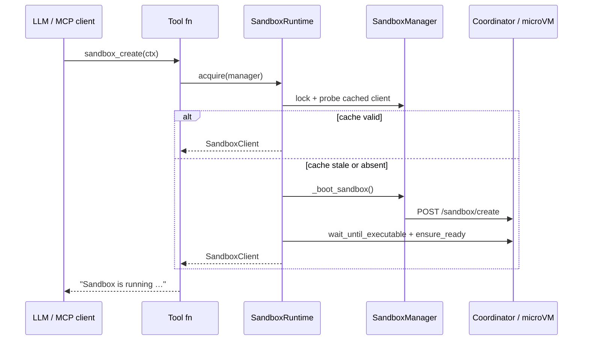

# Sandbox routing and lifecycle

How tool calls with **no `sandbox_id` argument** still all land in the same microVM, and how
sandboxes are created, reused, and destroyed.

See also [[Request context and headers]] for where `user_id` / `conversation_id` come from.

## The core idea

There is **no sandbox id parameter** because the sandbox is not addressed by the LLM — it is
addressed by the *server*, using the request headers as a key. A single long-lived
`MultiUserSandboxManager` holds a registry of sandboxes keyed by
**`{scope_id}:{lane_id}`** (fallback: `{user_id}:{conversation_id}`). Every tool call in the
same scope carries the same headers, resolves to the same registry entry, and therefore to
the same running VM.

```
x-sandbox-scope-id + x-sandbox-lane-id  ──►  SandboxManager  ──►  SandboxRuntime.acquire()  ──►  microVM
```

## Key components

### `SandboxRuntime` — unified acquisition (`sandbox_mcp/runtime.py`)

Single entry point for all tools:

- **Probe** cached client before reuse (`echo __probe__` via execute)
- **Boot** via `SandboxManager._boot_sandbox()` (create or lease lookup)
- **Readiness** — `wait_until_executable()` then `ensure_ready()`
- **Retry** — transient errors, `SandboxLeaseGone`, exponential backoff
- **Inventory** — fire-and-forget background task (never blocks acquire)

### `MultiUserSandboxManager` — the registry (`sandbox_mcp/manager.py`)

- Created **once** in `main.py`, shared across all requests.
- `get_manager(...)` returns the `SandboxManager` for `scope_id:lane_id`.
- `evict_idle()` destroys sandboxes idle longer than `SANDBOX_TTL_MINUTES`.
- Background eviction loop in `sandbox_mcp/eviction.py` (every 60s).

### `SandboxManager` — one scope's sandbox (`sandbox_mcp/manager.py`)

- Owns at most **one** `SandboxClient`, guarded by `asyncio.Lock`.
- `_boot_sandbox()` — create/reconnect only (no readiness, no inventory).
- `touch()` — updates `last_used_at` for TTL eviction.
- `destroy()` tears the VM down and clears the cache.

### `SandboxClient` — data-plane HTTP wrapper (`sandbox_mcp/client.py`)

- `probe()`, `wait_until_executable()`, `ensure_ready()`
- `resolve_lease()` — optional `GET /sandbox/lease` (feature flag)
- File ops via `POST /sandbox/execute`

## Create → reuse flow (sequence)



## Lifecycle states

| State | `is_alive` | How you get there |
|-------|-----------|-------------------|
| Registered, not booted | `False` | First `get_manager(...)` for the key. |
| Running | `True` | `SandboxRuntime.acquire()` succeeded. |
| Destroyed | `False` | `destroy()`, TTL eviction, or shutdown. |

> [!note]
> Every file/shell tool calls `SandboxRuntime.acquire()` via `_with_sandbox()`. `sandbox_create`
> is optional but recommended for eager boot + connection info.

## Multi-user isolation

- Different `scope_id:lane_id` → different managers → different VMs.
- Identity is fixed by headers ([[Request context and headers]]); no sandbox id tool argument.

## Production: multi-pod deployment

Use **sticky routing** on `x-sandbox-scope-id` + `x-sandbox-lane-id` so the same conversation
hits the same MCP pod. See `docs/coordinator/sticky-routing.md`.

If a pod dies, the next pod runs `acquire()` with an empty cache and reconnects via the
coordinator (idempotent create or `GET /sandbox/lease` when enabled).

## TTL eviction

`SANDBOX_TTL_MINUTES` (default 30) — idle sandboxes are destroyed automatically. Align MCP
TTL ≤ coordinator lease TTL.

## Remaining caveats

1. **Multi-pod without sticky routing** — duplicate VMs or cache misses. Use sticky routing.
2. **Identity trusted from headers** — gateway must set/strip headers; enforce `MCP_API_KEY`.
3. **`SandboxClient.destroy()`** uses sync `httpx.Client` — briefly blocks the event loop.

## Related

[[Request context and headers]] · [[sandbox_create]] · [[sandbox_info]] ·
[[sandbox_destroy]] · [[shell_exec]] · [[MCP Server Tools]]
